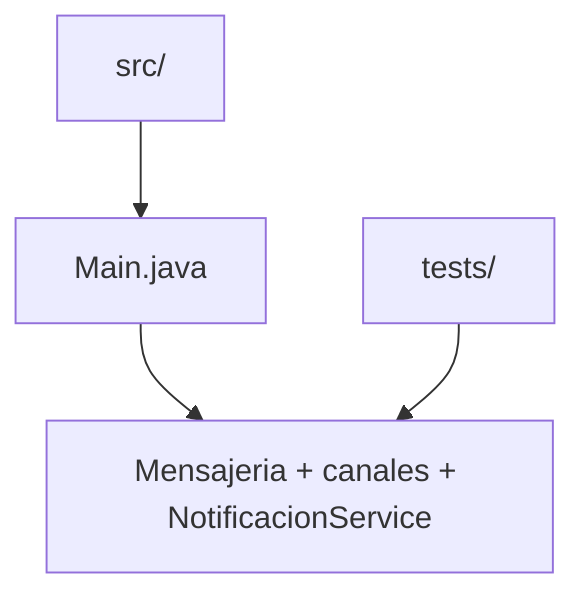
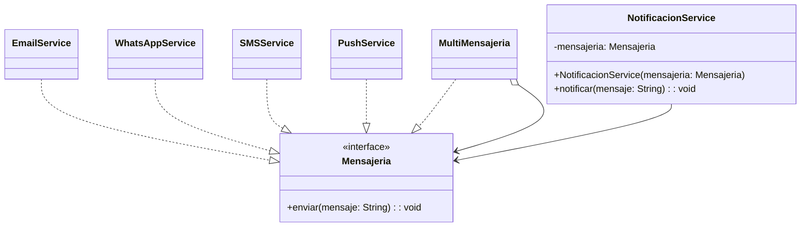

# Sistema de Notificaciones (DIP · SOLID) — Java (KISS)

Proyecto académico — Programación Orientada a Objetos.
Aplica el **Principio de Inversión de Dependencias (DIP)** e **Inyección de Dependencias**.
Diseño simplificado siguiendo **KISS**.

## Requisitos
- JDK 8+

## Parte 1 (anti-patrón, solo análisis)
```bash
javac -d src/parte1/target src/parte1/*.java
java -cp src/parte1/target Main
```
Salida esperada: `[EMAIL] Enviando: Hola por email`

## Estructura (estilo solicitado)
```
src/
  domain/        # Mensajeria + canales + MultiMensajeria
  services/      # NotificacionService
  controllers/   # Main (composition root)
  dao/           # (reservado, KISS: sin uso actual)
tests/           # tests unitarios JUnit 5
docs/            # UML y capturas
```

## Instalación y ejecución
```bash
# Compilar
mkdir target
javac -d target src/*.java

# Ejecutar demo
java -cp target Main
```

## Diagrama UML — comunicación (KISS)



## Diagrama de clases (DIP)



## Canales soportados
Email, WhatsApp, SMS, Push (+ multi-canal opcional).

## Respuestas conceptuales (Parte 4)
1. **DIP:** alto y bajo nivel dependen de abstracciones.
2. **Concreta vs interfaz:** la interfaz permite sustituir implementaciones sin modificar el consumidor.
3. **Inyección de dependencias:** entregar dependencias desde fuera.
4. **Ventajas por constructor:** objeto inicializado, dependencia inmutable, fácil de testear.
5. **Extensión:** basta crear una clase que implemente `Mensajeria`.
6. **DIP y OCP:** DIP habilita OCP.

## Documentación
- Plan: `PLAN_DE_IMPLEMENTACION.md`
- Agentes: `AGENTS.md`
- UML: `docs/uml.puml`
- Captura: `docs/capturas/salida.txt`
