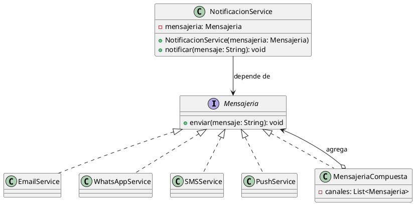

# Plan de Implementación — Sistema de Notificaciones (DIP)

**Materia:** Programación Orientada a Objetos
**Tema:** Principio de Inversión de Dependencias (DIP) e Inyección de Dependencias
**Modalidad:** Individual o en parejas
**Lenguaje elegido:** Java 17 (JDK estándar, sin frameworks obligatorios). Alternativa válida: C# / .NET 8 o Python 3.11+. El plan es agnóstico al lenguaje; los nombres de clases y métodos se mantienen.

> Nota: este documento es únicamente el **plan de implementación** (diseño y pasos). No contiene código ejecutable.

---

## 1. Objetivo y alcance

Diseñar un sistema de notificaciones que:

1. Envíe mensajes por al menos cuatro canales: **Email, WhatsApp, SMS y Push**.
2. Permita agregar nuevos canales **sin modificar** la clase principal `NotificacionService`.
3. Cumpla el principio DIP: las clases de alto nivel dependen de abstracciones, no de implementaciones concretas.
4. Use **inyección de dependencias por constructor**.
5. No contenga `if`, `switch` ni instanciación de concretos dentro de `NotificacionService`.

Entregables finales: código fuente ejecutable, diagrama UML, capturas de ejecución, respuestas conceptuales y `README.md` con instrucciones.

---

## 2. Estructura del proyecto

```
sistema-notificaciones/
├── src/
│   ├── model/          # abstracciones e implementaciones de canales + NotificacionService
│   ├── dao/            # acceso a datos (historial)
│   ├── controller/     # casos de uso
│   ├── view/           # presentación (consola)
│   └── main.py         # composition root
├── tests/              # tests unitarios (pytest)
├── docs/
│   ├── uml.puml
│   └── capturas/
├── AGENTS.md
├── README.md
├── requirements.txt
├── .gitignore
└── PLAN_DE_IMPLEMENTACION.md
```

Convenciones:
- Paquete base: `com.empresa.notificaciones`.
- Nombres en PascalCase para clases, camelCase para métodos/atributos.
- Cada canal implementa `Mensajeria`.
- `NotificacionService` solo conoce `Mensajeria`.

---

## 3. Diseño de clases (contrato)

### 3.1 Abstracción

| Clase/Interfaz | Tipo | Miembros |
|---|---|---|
| `Mensajeria` | interfaz | `void enviar(String mensaje)` |

### 3.2 Implementaciones concretas

| Clase | Implementa | Comportamiento de `enviar` |
|---|---|---|
| `EmailService` | `Mensajeria` | Imprime `[EMAIL] Enviando: <mensaje>` |
| `WhatsAppService` | `Mensajeria` | Imprime `[WHATSAPP] Enviando: <mensaje>` |
| `SMSService` | `Mensajeria` | Imprime `[SMS] Enviando: <mensaje>` |
| `PushService` | `Mensajeria` | Imprime `[PUSH] Enviando: <mensaje>` |

Cada implementación es independiente y no conoce a las demás ni a `NotificacionService`.

### 3.3 Clase de alto nivel

| Clase | Dependencias | Miembros |
|---|---|---|
| `NotificacionService` | `Mensajeria` (por constructor) | `private final Mensajeria mensajeria`; constructor `NotificacionService(Mensajeria)`; método `public void notificar(String mensaje)` que delega en `mensajeria.enviar(mensaje)`. |

Restricciones verificadas:
- No contiene `if`/`switch`.
- No instancia concretos (`new EmailService()` prohibido aquí).
- No importa implementaciones concretas.

### 3.4 Punto de entrada

`Main` (o `App`):
- Instancia cada canal concreto.
- Inyecta cada uno en un `NotificacionService` distinto (o reutiliza uno reasignando por nueva instancia, ya que la dependencia es `final`).
- Llama `notificar(...)` para demostrar los 4 canales.
- (Opcional) Demuestra el desafío multi-canal.

---

## 4. Parte 1 — Implementación inicial (anti-patrón, solo para análisis)

**Objetivo pedagógico:** mostrar el acoplamiento fuerte antes de refactorizar.

Pasos:
1. Crear `EmailService` con método `enviarEmail(String mensaje)` (o `enviar`).
2. Crear `NotificacionService` que **instancie internamente** `EmailService` (campo `private EmailService emailService = new EmailService();`) y llame `emailService.enviar(...)`.
3. Ejecutar y mostrar salida en consola.
4. Responder las preguntas de reflexión:
   - **¿Qué sucede si queremos enviar por WhatsApp?** Hay que modificar `NotificacionService` (o crear otra clase), porque está atado a `EmailService`.
   - **¿Qué clase deberíamos modificar?** `NotificacionService` (y posiblemente `Main`).
   - **¿Qué problema presenta este diseño?** Alto acoplamiento, violación de OCP y DIP; no es extensible sin modificar código existente; difícil de testear (no se puede sustituir por un mock).

> Esta versión se conserva en una rama/carpeta `parte1-acoplado` para la comparación en el informe, pero **no** forma parte de la solución final.

---

## 5. Parte 2 — Aplicación del DIP

Pasos de refactorización:
1. Crear interfaz `Mensajeria` con `void enviar(String mensaje)`.
2. Hacer que `EmailService` implemente `Mensajeria` (adaptar firma si en Parte 1 se usó otro nombre).
3. Crear `WhatsAppService` y `SMSService` implementando `Mensajeria`.
4. Modificar `NotificacionService`:
   - Campo `private final Mensajeria mensajeria`.
   - Constructor `NotificacionService(Mensajeria mensajeria)` que asigne el campo.
   - Método `notificar(String mensaje)` → `mensajeria.enviar(mensaje)`.
5. Verificar que no haya imports de concretos en `NotificacionService`.
6. En `Main`, demostrar intercambio de canales sin tocar `NotificacionService`:
   - `new NotificacionService(new EmailService())`
   - `new NotificacionService(new WhatsAppService())`
   - `new NotificacionService(new SMSService())`

---

## 6. Parte 3 — Extensión: notificaciones Push

Condición: **no modificar `NotificacionService`**.

Pasos:
1. Crear `PushService implements Mensajeria`.
2. En `Main`, agregar `new NotificacionService(new PushService())` y llamar `notificar(...)`.
3. Verificar que `NotificacionService` no cambió (diff vacío).

Esto demuestra OCP: el sistema se extiende agregando clases, no modificando las existentes.

---

## 7. Parte 4 — Análisis conceptual (respuestas modelo)

> Las respuestas finales deben estar en palabras propias del alumno; aquí se ofrece una guía.

1. **¿Qué establece DIP?**
   Los módulos de alto nivel no deben depender de módulos de bajo nivel; ambos deben depender de abstracciones. Además, las abstracciones no deben depender de detalles; los detalles deben depender de abstracciones.

2. **Diferencia entre depender de una clase concreta vs. una interfaz:**
   - Concreta: el código queda atado a una implementación específica; cambiarla obliga a modificar el consumidor.
   - Interfaz: el consumidor solo conoce el contrato; se puede sustituir la implementación sin tocarlo (polimorfismo).

3. **¿Qué es la inyección de dependencias?**
   Es un patrón por el cual las dependencias de un objeto se le entregan desde fuera (por constructor, setter o campo) en lugar de que el objeto las cree internamente.

4. **Ventajas de la inyección por constructor:**
   - Garantiza que el objeto queda completamente inicializado.
   - Permite declarar la dependencia como `final`/inmutable.
   - Facilita pruebas unitarias (se inyectan mocks).
   - Hace explícitas las dependencias.

5. **¿Por qué el diseño facilita agregar funcionalidades?**
   Porque `NotificacionService` depende de `Mensajeria`; basta con crear una nueva clase que implemente la interfaz y pasarla al constructor, sin modificar código existente.

6. **Relación DIP ↔ OCP:**
   DIP habilita OCP: al depender de abstracciones, se pueden agregar nuevas implementaciones (extensiones) sin modificar las clases existentes (cerradas a modificación).

---

## 8. Desafío opcional — Multi-canal simultáneo

**Objetivo:** enviar una misma notificación por varios canales sin modificar las implementaciones existentes ni `NotificacionService`.

Diseño propuesto (nueva clase, no modifica existentes):
- Crear `MensajeriaCompuesta` (o `MultiMensajeria`) que implemente `Mensajeria` y reciba `List<Mensajeria>` por constructor.
- Su método `enviar(mensaje)` itera la lista y llama `enviar` en cada una.
- Uso: `new NotificacionService(new MensajeriaCompuesta(List.of(new EmailService(), new SMSService())))`.

Verificaciones:
- No se modifica `NotificacionService`.
- No se modifica `EmailService`, etc.
- No se usan `if`/`switch` para decidir canal (la iteración es sobre la lista, no una decisión por tipo).
- DIP se mantiene: `MensajeriaCompuesta` depende de la abstracción `Mensajeria`.

---

## 9. Diagrama UML (solución final)

Representación en PlantUML (guardar como `docs/uml.puml`):



Relaciones:
- Realización: `EmailService`, `WhatsAppService`, `SMSService`, `PushService`, `MensajeriaCompuesta` → `Mensajeria`.
- Asociación/dependencia: `NotificacionService` → `Mensajeria`.
- Agregación: `MensajeriaCompuesta` → `Mensajeria` (0..*).

---

## 10. Plan de ejecución / cronograma sugerido

| Paso | Actividad | Entregable |
|---|---|---|
| 1 | Crear estructura de proyecto y `README` inicial | árbol de carpetas |
| 2 | Parte 1: implementación acoplada + reflexión | código + notas |
| 3 | Parte 2: interfaz + 3 canales + refactor | código refactorizado |
| 4 | Parte 3: `PushService` sin tocar `NotificacionService` | código + diff vacío |
| 5 | (Opcional) Desafío multi-canal | `MensajeriaCompuesta` |
| 6 | Generar diagrama UML (`docs/uml.puml`) | PNG/SVG |
| 7 | Ejecutar y capturar salida de los 4 canales | `docs/capturas/` |
| 8 | Redactar respuestas conceptuales (Parte 4) | sección en README o informe |
| 9 | Completar `README.md` con instrucciones de ejecución | README final |
| 10 | Revisión contra criterios de evaluación | checklist |

---

## 11. Plan de pruebas / demostración

Casos a ejecutar en `Main`:
1. Notificación por Email → salida `[EMAIL] ...`.
2. Notificación por WhatsApp → salida `[WHATSAPP] ...`.
3. Notificación por SMS → salida `[SMS] ...`.
4. Notificación por Push → salida `[PUSH] ...`.
5. (Opcional) Notificación multi-canal → salida de todos los canales elegidos.
6. Verificación estática: `grep` de `NotificacionService` no contiene `if`, `switch`, `new` de concretos ni imports de implementaciones.

Comando de ejecución (Java, sin Maven):
```bash
cd src/main/java
javac com/empresa/notificaciones/*.java
java com.empresa.notificaciones.Main
```

---

## 12. Checklist de criterios de evaluación

- [ ] Interfaces/abstracciones implementadas (20) — `Mensajeria`.
- [ ] DIP aplicado correctamente (25) — dependencia a abstracción.
- [ ] Inyección por constructor (20) — constructor con `Mensajeria`.
- [ ] Nuevos canales sin modificar `NotificacionService` (15) — Push + multi-canal.
- [ ] Diagrama UML (10) — `docs/uml.puml`.
- [ ] Respuestas conceptuales (10) — Parte 4.
- Restricciones: sin `if`/`switch` ni instanciación de concretos en `NotificacionService`; ≥4 canales demostrados.

---

## 13. Riesgos y consideraciones

- **Nombres de métodos:** definir desde el inicio `enviar(String)` en la interfaz para evitar refactor de firmas.
- **Mutabilidad:** marcar la dependencia como `final` para garantizar inmutabilidad.
- **Pruebas:** si se usan mocks, la interfaz facilita la sustitución; no es obligatorio usar frameworks.
- **Diagrama:** mantener el UML sincronizado con el código final (regenerar tras cambios).
- **Capturas:** ejecutar con la misma versión final del código para que las salidas coincidan.

---

## 14. README.md (plantilla de instrucciones)

```markdown
# Sistema de Notificaciones (DIP)

## Requisitos
- JDK 17+

## Compilar y ejecutar
cd src/main/java
javac com/empresa/notificaciones/*.java
java com.empresa.notificaciones.Main

## Estructura
(ver sección 2 del plan)

## Canales soportados
Email, WhatsApp, SMS, Push (+ multi-canal opcional)
```

---

## 15. Arquitectura extendida: MVC + DAO + Tests

### 15.1 Capas
- **Model (`src/model/`)**: `Mensajeria` (ABC), canales (`EmailService`, `WhatsAppService`, `SMSService`, `PushService`, `MultiMensajeria`) y `NotificacionService`. No dependen de DAO ni View.
- **DAO (`src/dao/`)**: `NotificacionDAO` persiste el historial de notificaciones (en memoria). Solo depende de modelos.
- **Controller (`src/controller/`)**: `NotificacionController` orquesta el caso de uso: llama al servicio y registra en el DAO.
- **View (`src/view/`)**: `ConsolaView` presenta resultados; sin lógica de negocio.
- **Composition root (`src/main.py`)**: instancia e inyecta dependencias.

### 15.2 Separación de la lógica
- La lógica de negocio (delegación al canal) vive en `NotificacionService`.
- La lógica de persistencia vive en `NotificacionDAO`.
- La lógica de presentación vive en `ConsolaView`.
- Los controladores solo coordinan; no contienen reglas de negocio.

### 15.3 Tests unitarios (`tests/`)
- `test_notificacion_service.py`: inyección y delegación (con fake).
- `test_canales.py`: salida de los 4 canales + abstracción.
- `test_dao.py`: guardar/listar/limpiar.
- `test_controller.py`: envío + persistencia.
- `test_multi.py`: desafío opcional multi-canal.
- Los tests no tocan el sistema de archivos real; usan fakes/mocks.

### 15.4 Archivos de proyecto
- `AGENTS.md`: reglas para agentes de código.
- `README.md`: instrucciones de instalación/ejecución.
- `requirements.txt`: dependencias (pytest, pytest-cov).
- `.gitignore`: artefactos de Python, IDE, OS, cobertura.

### 15.5 Comandos
```bash
pip install -r requirements.txt
python -m src.main
pytest -q
pytest --cov=src
```

---

**Fin del plan.** Una vez aprobado, se procede a la implementación siguiendo los pasos de la sección 10.
